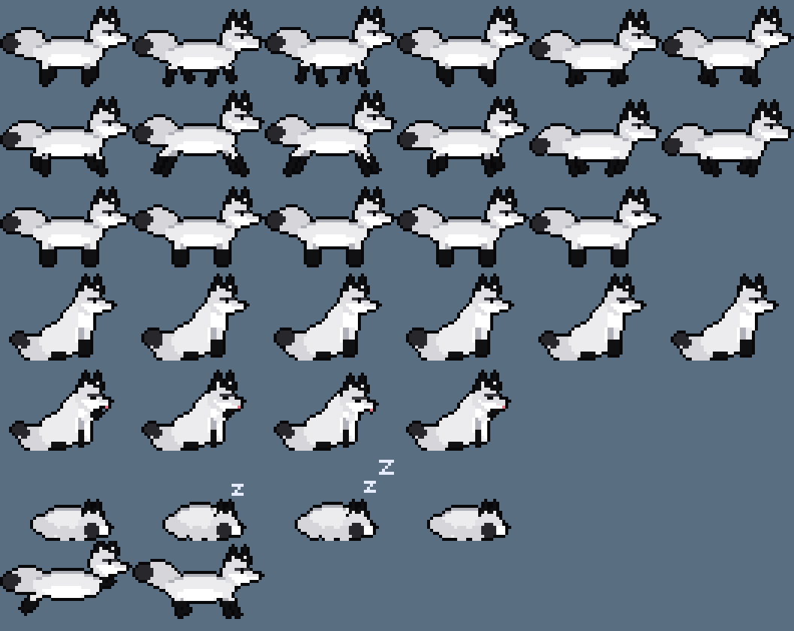
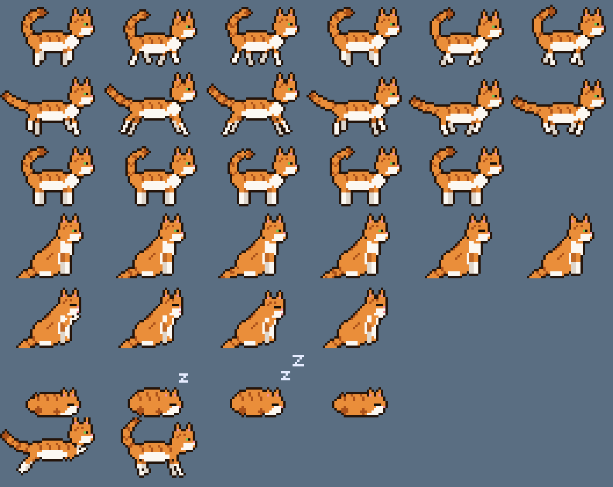
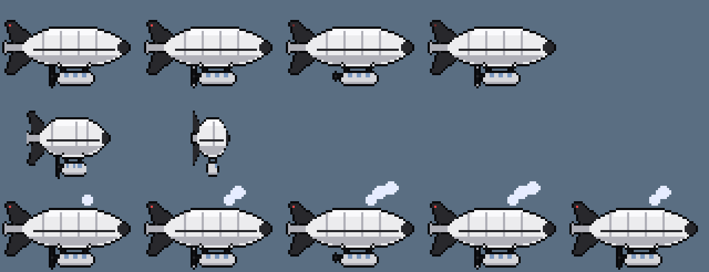
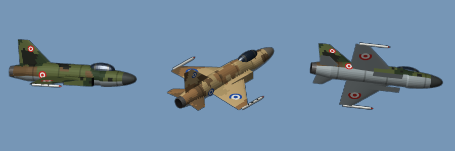

# gnome_sprites

Пиксельные питомцы и воздушный бой для рабочего стола GNOME Shell (45–50).

| | |
|---|---|
| **Fox Pet** (`fox-pet@local`) | Лиса бегает по низу экрана и по верхним краям окон, сидит, умывается, спит, прыгает. |
| **Cat Pet** (`cat-pet@local`) | Рыжая кошка с белыми лапками. Умеет всё то же, что лиса: ходит, бегает, запрыгивает на окна, умывается, спит. |
| **Airship Pet** (`airship-pet@local`) | Дирижабль плывёт по верхней части экрана, покачивается, крутит пропеллером, разворачивается и пускает пар. |
| **Dogfight** (`dogfight@local`) | Воздушный бой в псевдо-3D: камуфляжные истребители «лес» против «пустыни» (от 1×1 до 4×4), видны сбоку, сверху, снизу, спереди — с креном в виражах и перспективой по глубине. Сбитые падают горящими и взрываются о низ экрана, пилоты катапультируются и спускаются на парашютах. Счёт в меню. Не перехватывает клики. |






## Установка

```bash
git clone https://github.com/MaximovIlya/gnome_sprites.git
cd gnome_sprites
./install.sh            # все расширения
./install.sh airship    # только дирижабль
./install.sh fox        # только лиса
./install.sh cat        # только кошка
./install.sh dogfight   # только воздушный бой
```

Затем выйдите из системы и войдите снова (Wayland). На X11 можно перезапустить shell: `Alt+F2` → `r` → `Enter`.

Проверка: `gnome-extensions info airship-pet@local` должно показать `State: ACTIVE`.

## Управление

- **Клик**: лиса или кошка подпрыгивает, дирижабль даёт гудок (клубы пара).
- **Перетаскивание**: питомца можно взять мышью и бросить. Лиса и кошка падают, дирижабль по инерции плывёт и возвращается на высоту.
- **Меню на панели**: показать или скрыть питомца, следовать за курсором, «поверх окон» или «на рабочем столе», позвать к курсору и т. д.

Настройки хранятся в `~/.config/fox-pet.json`, `~/.config/cat-pet.json`, `~/.config/airship-pet.json` и `~/.config/dogfight.json`.

**Воздушный бой**: меню на панели показывает счёт. Там же можно скрыть бой, переключить «поверх окон», выбрать число самолётов в команде (1×1 … 4×4) и начать новый бой.

## Спрайты

Спрайты рисуются кодом через Pillow:

```bash
python3 fox-pet@local/tools/gen_fox.py fox-pet@local/sprites
python3 cat-pet@local/tools/gen_cat.py cat-pet@local/sprites
python3 airship-pet@local/tools/gen_airship.py airship-pet@local/sprites
python3 dogfight@local/tools/gen_sprites3d.py dogfight@local   # 3D-рендер на чистом Python + Pillow
```

## Удаление

```bash
gnome-extensions disable airship-pet@local
rm -rf ~/.local/share/gnome-shell/extensions/airship-pet@local
```
